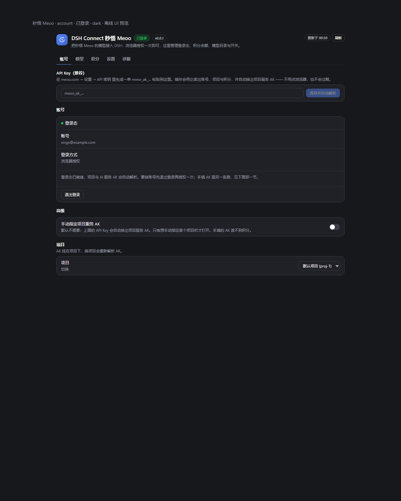
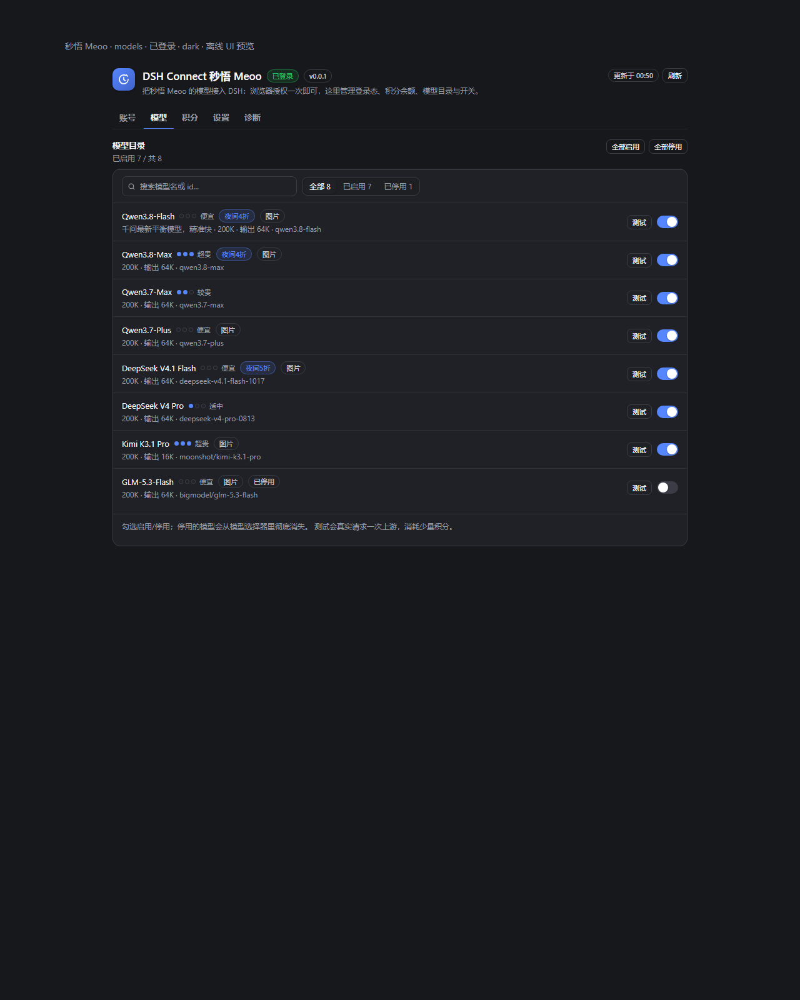
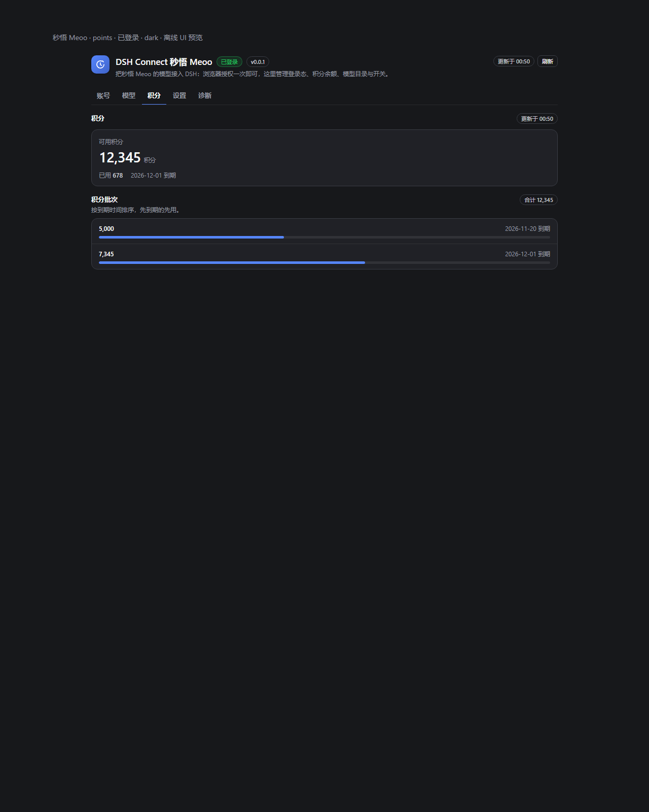
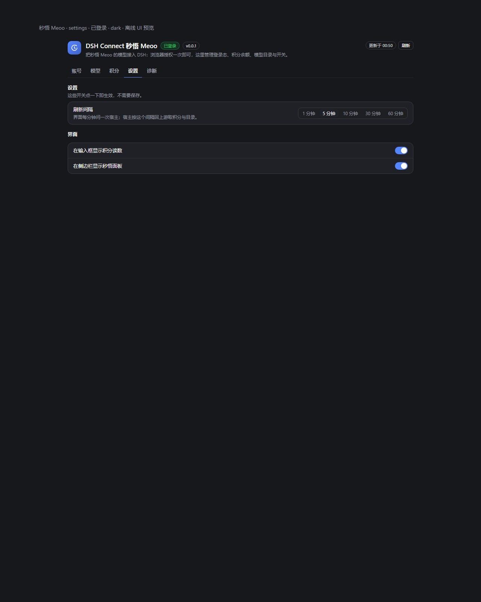
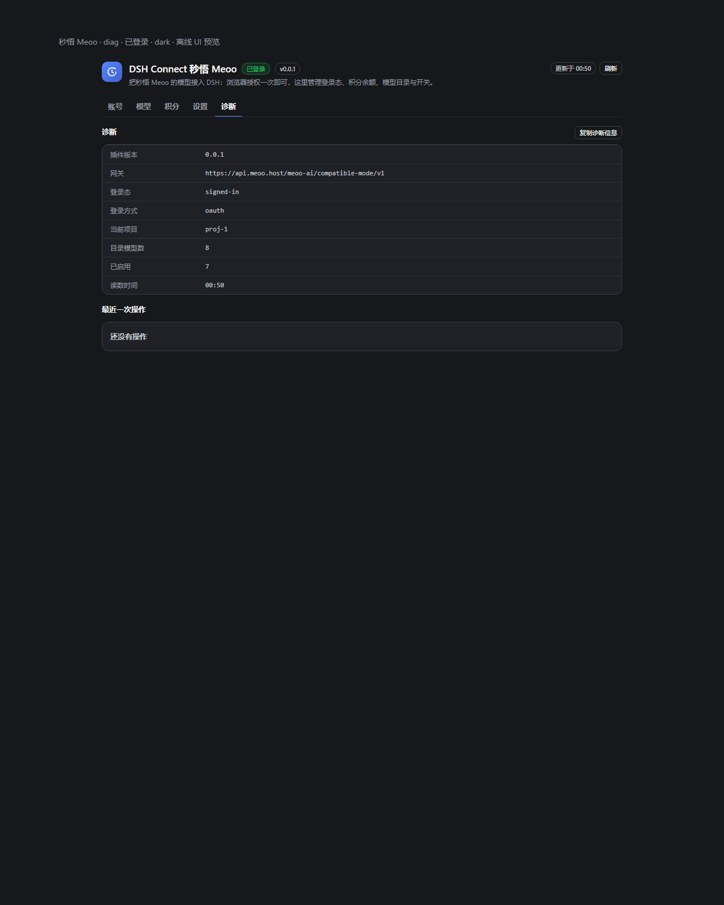
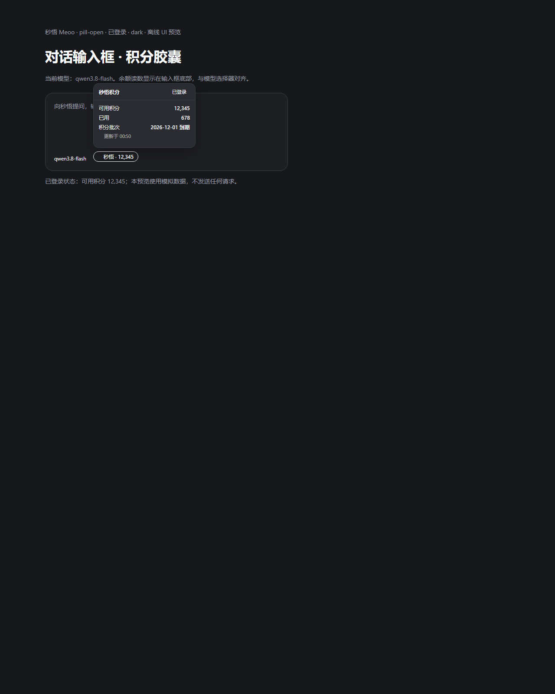

# dsh-connect-meoo

把 [秒悟 Meoo](https://meoo.com)（`meoo.com`）的模型接进 [DeepSeek Harness](https://github.com/deepseek-ai/deepseek-harness)（DSH）。

装上之后：

1. **模型选择器里多出「Meoo 秒悟」一组** —— 随时切换，像原生 provider 一样用。
2. **设置 → 秒悟** 一页管全部：账号 / 模型 / 积分 / 设置 / 诊断，五个分栏。
3. **模型目录对齐官网** —— 价格档位（便宜/适中/较贵/超贵）、夜间折扣、一句话说明、上下文与输出上限，全部取自官网同一份接口。
4. **输入框左侧有积分胶囊** —— 只在选中 Meoo 模型时出现，点开看余额与到期。
5. **可选侧栏整页** —— 默认关，勾上才占全局侧栏座位。

界面沿用 `dsh-connect-workbuddy` 的设计语言：一个主题一张圆角卡片、行间只用 1px 分隔线、
节标题在卡片外、状态用色点与胶囊表达、设置项是开关（点一下即生效）。
暗色 / 亮色都直接吃 DSH 主题变量，不写死颜色。

| 账号 | 模型 |
| --- | --- |
|  |  |

| 积分 | 设置 |
| --- | --- |
|  |  |

| 诊断 | 输入框胶囊（点开） |
| --- | --- |
|  |  |

截图由 `node scripts/preview-ui.mjs` 用**真实组件 + mock 状态文档**离屏渲染再截，
不是手绘稿：组件改错会立刻在图上露出来（空白、NaN、错位）。

```bash
node scripts/preview-ui.mjs               # 生成 HTML + 暗色截图
node scripts/preview-ui.mjs --theme light # 亮色
node scripts/preview-ui.mjs --no-shot     # 只出 HTML，不截图
node scripts/preview-ui.mjs --check       # 只自检（gate 用的就是这一条）
```

亮色版与未登录变体（`*-light*.png` / `*-signedout*.png`）和中间 HTML 不入库，
需要时现场生成：`docs/assets/preview/` 与这些变体都在 `.gitignore` 里。

## 它和 dsh-connect-workbuddy 的关系

同一个形态（DSH 双面 bundle 插件 + 模型 provider + 设置卡片 + 输入框胶囊），
但**接的是 Meoo 的官方 AI 服务网关**，不是伪装客户端：

| | workbuddy | 本插件 |
| --- | --- | --- |
| 上游 | 客户端私有接口（非官方开放 API） | Meoo 官方「AI 服务」网关（OpenAI 兼容） |
| 鉴权 | 复用客户端登录态 + 伪装 CLI 指纹 | OAuth(PKCE) → 项目服务 AK，官方公开契约 |
| 中间层 | 回环 shim 翻译协议 | **没有** —— 网关本身就是 OpenAI 兼容 |
| 计费 | 积分倍率 | 账号积分（`/account/points` 只读读数） |

## 它是怎么做的

```
dsh-connect-meoo (Host)
  ├─ OAuth(PKCE) 登录 meoo.com       → access/refresh token 存 $DSH_HOME/meoo/state.json
  ├─ /open/v1/cli-compat/…           → 身份、项目列表、项目服务 AK
  │                                    （项目没开通云服务时自动开通一次）
  ├─ GET {gateway}/models            → 当前可用模型目录
  └─ ctx.llm.registerAdapter(meoo)   → 每次请求现场解析 AK 作 apiKey
                                          ↓
                          pi-ai 直接转发到 Meoo 网关（流式、工具调用）
                                          ↓
                     模型选择器「Meoo 秒悟」 + 设置卡片 + 积分胶囊
```

**没有本地 shim**：Meoo 网关本身就是 OpenAI Chat Completions 兼容的
（`https://api.meoo.host/meoo-ai/compatible-mode/v1`），pi-ai 直接以
「项目服务 AK 作 apiKey + 网关作 baseURL」转发。少一层代理就少一类掉流式的故障。

## 登录：三条路，API Key 最省事

| 方式 | 成本 | 能读积分 | 会过期吗 |
| --- | --- | --- | --- |
| **API Key**（推荐） | 粘一个 `meoo_ak_…` | ✅ | 不会 |
| 浏览器授权 | 点一次「授权」 | ✅ | token 1 小时自动续期 |
| 项目服务 AK | 自己去云服务页复制 87 字符（已收进「高级」，默认不显示） | ❌ | 长期，但换项目要换 |

### 为什么 API Key 是首选

`meoo_ak_…` 是**控制面凭证**，和 OAuth token 同一层：能读身份、项目列表、积分余额、
套餐额度。插件拿到它之后自己换出**项目服务 AK**（网关凭证），全程不用点浏览器：

```
贴 meoo_ak_… → 读身份 → 列项目 → 读积分 → 解析项目服务 AK → 拉模型目录
                （项目没开通云服务时自动开通一次）
```

在 `meoo.com → 设置 → API 密钥` 生成一串，粘到「设置 → 秒悟 → API Key」即可。

> **两种 key 别混**：`meoo_ak_…` 是控制面 API Key，**不能**直接调模型网关
> （网关会回 `401 SERVICE_AK_FORMAT_INVALID`）；`meoo_project_service_v1.…` 才是网关凭证。
> 插件会自动完成这次转换，所以你只需要填前者。

## 浏览器授权：不想生成 key 时的备选

| 环节 | 谁来做 | 需要人工吗 |
| --- | --- | --- |
| OAuth(PKCE) 拿 token | 插件起本机随机端口回调 | **点一次「授权」** |
| 1 小时后续期 | refresh token 自动轮换（原子保存） | 不需要 |
| 选项目 | 账号默认项目；多项目时让你在卡片里选 | 不需要 |
| 取项目服务 AK | `GET …/projects/{id}/cloud/environment` 里的 `meooProjectApiKey` | 不需要 |
| 项目没开通云服务 | 自动 `POST …/cloud` 开通一次再取 | 不需要 |
| 拉模型目录 | `GET {gateway}/models` | 不需要 |

想完全不走浏览器也可以：

- **项目服务 AK**：卡片「账号」栏里粘 `meoo_project_service_v1.…`（会先用网关验一次）。
  注意它**读不到积分账户**，这是上游事实：`/account/points` 只认控制面凭证
  （OAuth token 或 API Key），项目服务 AK 只是网关 Bearer。想用积分卡就用上面两种。
- **复用本机登录态**：若你装过 `dsh-meoo-connect` 或 `meoo-proxy`，插件会**只读**
  复用它们已保存的登录态（一个字节都不写回）。

## 安装

dsh 的插件装在 **profile** 里（本机 Web GUI 用 `desktop` 或 `web`）。

```bash
# 本地目录（改代码时用）
dsh plugin --profile desktop add file:X:/Agent/deepseek插件/dsh-connect-meoo
```

然后把包名加进 profile 的 bundle 列表（`$DSH_HOME/profiles/<profile>/package.json`）：

```json
{
  "dsh": {
    "profile": {
      "bundles": [
        "@deepseek-ai/dsh-base",
        "@deepseek-ai/dsh-web-app",
        "dsh-connect-meoo"
      ]
    }
  }
}
```

**重启 dsh**（bundle 挂载要重组插件树，热加载不会加载新 bundle）。

## 配置

```yaml
- id: dsh-connect-meoo
  name: dsh-connect-meoo
  config:
    enabled: true
    apiBaseUrl: ''                    # 留空 = https://meoo.com
    gatewayBaseUrl: ''                # 留空 = https://api.meoo.host/meoo-ai/compatible-mode/v1
    serviceAk: ''                     # 手填项目服务 AK（兜底）
    reuseLocalLogin: true             # 只读复用 dsh-meoo-connect / meoo-proxy 的登录态
    projectUrlId: ''                  # 指定项目；留空用账号默认项目
    defaultReasoningEffort: ''        # off / low / medium / high
    warmOnStart: true                 # 启动时预拉一次目录与积分
```

界面开关（胶囊 / 侧栏 / 刷新间隔 / 禁用模型）**不进 settings**，落在
`$DSH_HOME/dsh-connect-meoo-state.json`，点一下即生效、不需要保存。

## 命令

| 命令 | 作用 |
| --- | --- |
| `/meoo` | 状态：账号、项目、AK、模型、上次同步 |
| `/meoo login` | 浏览器授权（PKCE），完成后自动同步 |
| `/meoo sync` | 重新解析 AK + 拉模型目录 |
| `/meoo models` | 列当前模型 |
| `/meoo project <urlId>` | 换项目（AK 会重新解析） |
| `/meoo key <ak>` | 手填项目服务 AK |
| `/meoo apikey <meoo_ak_…>` | 手填控制面 API Key，自动换出项目服务 AK |
| `/meoo logout` | 清本插件保存的登录态 |

## 排错

| 现象 | 处理 |
| --- | --- |
| 模型选择器里没有 Meoo | 重启 dsh；卡片「诊断」栏看 `lastError` |
| `网关拒绝了这个 AK（HTTP 401）` | AK 属于别的项目或没开通云服务；换项目或去 meoo.com 开通 |
| `项目 xxx 还没开通 Meoo AI 服务` | 去 meoo.com 该项目 → 云服务 开通，或在该项目对话框里发一句「帮我开启云服务」 |
| `账号下有多个项目` | 卡片「账号」栏里选一个（AK 挂在项目下，计费归属不同） |
| `登录态已失效` | 点「登录秒悟」重新授权 |
| 积分显示「暂时读不到」 | 手填项目服务 AK 读不到积分账户；改用 API Key 或浏览器授权 |

## 风险与边界

- 用的是 Meoo **官方「AI 服务」网关**，鉴权就是账号的项目服务 AK；每次调用消耗
  **你自己账号**的积分，插件不绕过任何计费、不刷额度、不碰账号状态。
- 插件**只读**别人的登录态文件（`dsh-meoo-connect` / `meoo-proxy`），写只写自己的。
- 凭据只留在本机（`$DSH_HOME/meoo/state.json`，权限 600），**不进浏览器页面**：
  页面只拿宿主归一好的展示数据，所有写操作走动作白名单。
- 与 Meoo 官方无关联，是第三方集成。

## 开发

```bash
node scripts/gate.mjs        # 十四道门，任何一项失败即非 0 退出
node scripts/probe.mjs       # 现场探测端点与本机登录态（不花钱）
node scripts/preview-ui.mjs  # 离屏渲染 UI 并截图到 docs/assets
```

`gate.mjs` 的十四道门：

| 门 | 守什么 |
| --- | --- |
| `typecheck` | TypeScript 严格模式（含 `noUncheckedIndexedAccess`） |
| `build` | tsdown 产出 `lib/index.js` + `.d.ts` |
| `copy-client` | 浏览器半边原样拷进 `lib/client.js` |
| `check-client` | 经典脚本契约：可解析、无 import/export、i18n 键齐全、状态字段都存在 |
| `check-claims` | 文档里不许写没有 HTTP 码 / 业务码支撑的「做不到」 |
| `check-doc-contract` | **文档承诺的功能必须在代码里存在**（上一版漏了 `/meoo` 命令） |
| `prepublish-check` | 产物形状、版本号一致、路由存在 |
| `check-pack` | 真实 tarball 清单：产物齐全、源码/测试没进包 |
| `check-host` | 宿主真能 `import()` 这个包、`dsh` 声明与 patch row name 都对 |
| `check-cordis` | **用真的 Cordis `Context` 装载一次**，含卸载释放（假 ctx 验不出 Cordis 接不接受） |
| `check-endpoint-evidence` | 写「上游没有某接口」必须指向一份带**对照组**的取证记录 |
| `tests` | 140 个单测（含**浏览器半侧真实渲染**：组件函数真的被执行一遍，含开关语义/搜索过滤/胶囊弹层） |
| `preview-ui` | 浏览器半侧离屏渲染 16 个页面：非空、CSS 已注入、无 `undefined`（`--check` 模式，不落盘不截图） |
| `smoke-apply` | 真跑一次 `apply()` 并验证注册内容 |

联网取证（按需手动跑，不花钱）：

```bash
node scripts/probe-endpoints.mjs   # 「上游没有 X 接口」的对照组取证
```

真网关的端到端验证需要真实账号（浏览器授权一次），见 `docs/VERIFY.md`。

## License

MIT。协议取证来源见 [`docs/PROTOCOL.md`](docs/PROTOCOL.md)。
